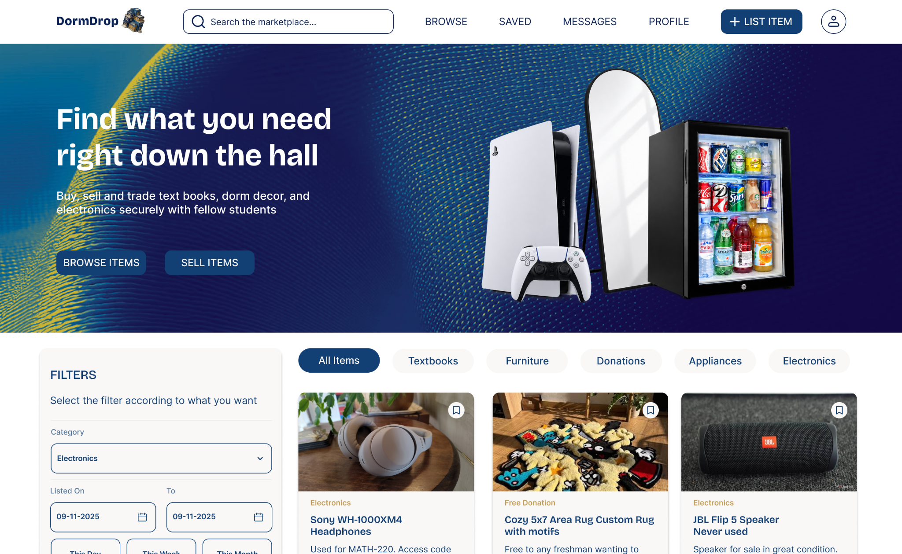
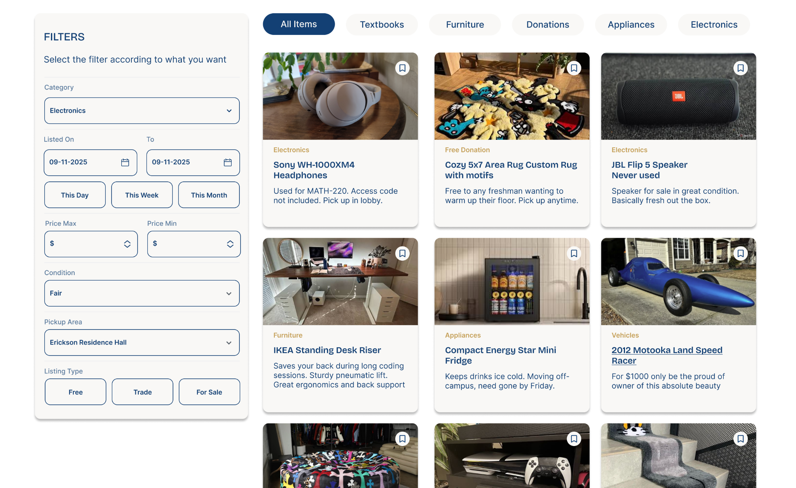
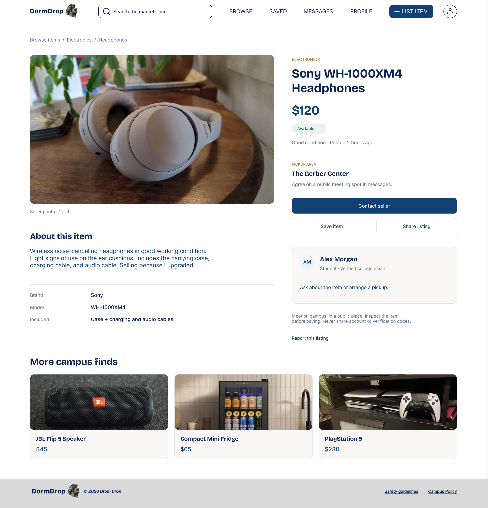
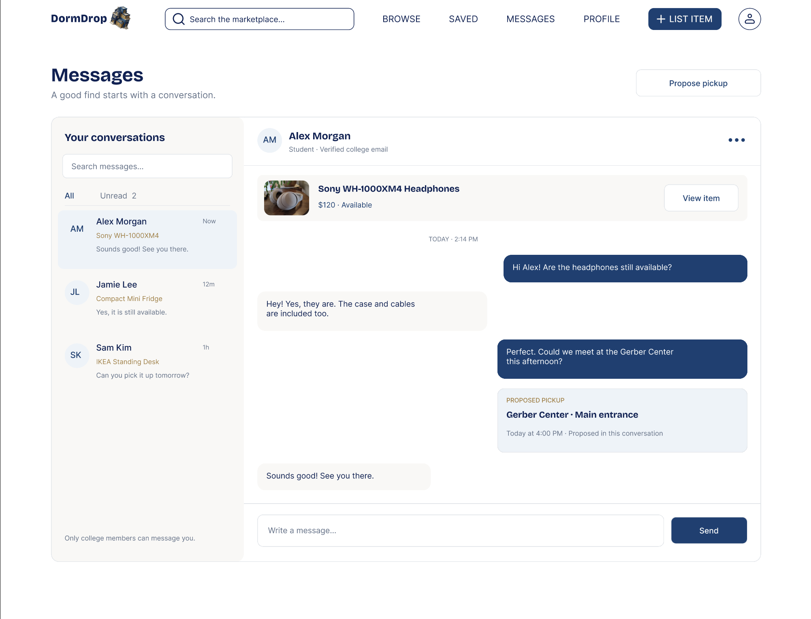
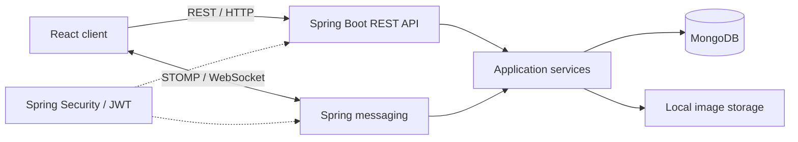

<p align="center">
  
</p>

<h1 align="center">DormDrop</h1>
<p align="center"><strong>Find what you need, right down the hall.</strong></p>

<p align="center">
  A campus marketplace for Augustana College students to buy, sell, trade, and give away items.
  Discover nearby listings, save interesting finds, and message other students to arrange an exchange.
</p>

<p align="center"><strong>Status:</strong> Working local MVP · Four-person student team · Not yet deployed</p>

<p align="center">
  <a href="#screenshots">Screenshots</a> ·
  <a href="#features">Features</a> ·
  <a href="#architecture">Architecture</a> ·
  <a href="#run-locally">Run locally</a> ·
  <a href="#team--contributions">Team</a>
</p>

## Screenshots

### Marketplace



<details>
<summary><strong>More interface screenshots — browsing, item details, and messages</strong></summary>

### Search and filters


### Item details


### Messaging interface preview


</details>

> **Screenshot note:** These are project interface captures, not a hosted/live demo. The messaging image includes a **pickup-proposal design**; according to the current implementation notes, proposal controls are not yet connected in the messaging frontend. The underlying backend pickup-proposal endpoints exist.

**Video demo:** Not recorded yet. The MVP currently runs locally; once a sanitized two-account walkthrough is recorded, its link will go here. See the [capture guide](docs/DEMO_AND_SCREENSHOTS.md).

## Features

- **Browse and discover:** Search by title/description/category; filter by category, price, condition, listing type, pickup area, and date; open item details.
- **Create and manage listings:** Add an item with a photo, price, description, condition, and campus pickup area; edit listings, mark them sold, and relist items.
- **Save items:** Bookmark listings and manage saved items from a dedicated page.
- **Real-time conversations:** Contact sellers from a listing; exchange messages over STOMP/WebSockets with conversation history stored in MongoDB; see unread conversations and recover messages through the REST API.
- **Campus accounts:** Register with an `@augustana.edu` address, verify via email, sign in using JWT-based authentication, and manage a profile.

**Scope:** DormDrop facilitates campus discovery and buyer–seller communication. It does not process payments, ship items, or settle trades.

## Technology

| Area | Stack |
| --- | --- |
| Frontend | React, JavaScript, Vite, React Router, CSS |
| Forms and HTTP | React Hook Form, Zod, Axios |
| Backend | Java, Spring Boot, Spring Web MVC, Spring Security, Maven |
| Data | MongoDB; server-side local image uploads |
| Authentication | JWT, BCrypt, Spring Mail verification |
| Real-time messaging | STOMP over WebSocket; REST for history and recovery |
| Team workflow | Git, GitHub, pull requests, Agile sprints |

## Architecture



**Typical message flow:** A student opens a conversation associated with a listing. The frontend loads chat history through the REST API and subscribes to live updates over STOMP/WebSockets. Messages are retained in MongoDB so conversations can be retrieved after a reload or reconnection. The backend handles authentication and messaging while React renders incoming messages.

The diagram shows the high-level design rather than every class or endpoint. See [`frontend/src/`](frontend/src/) and [`backend/src/main/`](backend/src/main/) for implementation details.

## Run locally

### Prerequisites

- **Node.js 22.12+** and npm for the Vite frontend (per current project notes).
- **Java and Maven** compatible with [`backend/pom.xml`](backend/pom.xml) (the documented Java target is 17).
- **MongoDB**, local or hosted.
- **SMTP credentials** and an Augustana email inbox to test the normal verification flow.

The following steps are adapted from the project configuration notes; **they have not been verified from a clean checkout here**. If a dependency or version fails, consult the current `package.json` and `pom.xml` in your branch.

### 1. Clone

```bash
git clone https://github.com/fiatbruno/dormdrop.git
cd dormdrop
```

### 2. Start the backend

Set the variables in the terminal that launches Spring Boot (or the corresponding IDE run configuration). Replace sample values with your own; **never commit real secrets**.

```bash
export MONGODB_URI='mongodb://localhost:27017/dormdrop'
export JWT_SECRET="$(openssl rand -base64 32)"
export MAIL_USERNAME='your-smtp-account@example.com'
export MAIL_PASSWORD='your-smtp-app-password'
export ADMIN_EMAIL='your-admin@augustana.edu'
export ADMIN_PASSWORD='choose-a-unique-admin-password'
export ADMIN_NAME='DormDrop Administrator'

cd backend
mvn spring-boot:run
```

The documented API base is `http://localhost:8080/api/v1`. When the server is running, check its health endpoint:

```bash
curl http://localhost:8080/api/v1/healthCheck
```

The backend does **not** automatically load `.env` files. The admin variables configure a development seed account when the users collection is empty; the usual student signup still uses verification emails.

### 3. Start the frontend

From a **second terminal** at the repository root:

```bash
cd frontend
npm ci
npm run dev -- --port 5173 --strictPort
```

Open `http://localhost:5173`. The frontend defaults to `http://localhost:8080/api/v1`. To use another API host, create `frontend/.env` with:

```dotenv
VITE_API_URL=http://localhost:8080/api/v1
```

Restart Vite after editing its environment configuration. **Never put secrets in `VITE_` variables:** they are shipped to the browser. The documented local CORS/WebSocket configuration expects port **5173**.

### Development checks

```bash
# Inside frontend/
npm run build
npm run lint

# Inside backend/
mvn test
```

These are available development commands, **not a claim of passing tests or comprehensive coverage**. The supplied project notes indicate that a usable frontend automated test suite is not yet present.

## Project structure

```text
dormdrop/
├── frontend/
│   └── src/
│       ├── api/          # REST clients
│       ├── auth/         # Authentication/session state
│       ├── components/   # Shared UI components
│       ├── hooks/        # Feature hooks
│       ├── pages/        # Marketplace and account screens
│       └── schemas/      # Client-side form validation
├── backend/
│   ├── pom.xml
│   └── src/main/
│       ├── java/edu/augustana/csc305/project/
│       │   ├── config/      # Server / socket configuration
│       │   ├── controller/  # REST endpoints
│       │   ├── dto/         # Request / response models
│       │   ├── model/       # Data models
│       │   ├── repository/  # MongoDB access
│       │   ├── security/    # Authentication / authorization
│       │   └── service/     # Business logic
│       └── resources/       # Application settings
└── docs/
    ├── screenshots/       # UI captures
    ├── DEMO_AND_SCREENSHOTS.md
    └── SECURITY.md
```

## Team & contributions

DormDrop began as an **Augustana College CSC 305** software engineering project developed by a **four-person team**.

**Girishya Fiat Bruno ([@fiatbruno](https://github.com/fiatbruno)) — frontend, messaging, and repository maintenance:**

- Designed the interface and developed substantial React UI work, including the marketplace, item details, registration, and reusable navigation and listing components.
- Worked on real-time buyer–seller messaging using Spring Boot WebSockets/STOMP and MongoDB-backed conversation history.
- Debugged frontend/backend API integration, used Postman to inspect requests, and added form validation using React Hook Form and Zod.
- Set up and maintained the team repository and Git collaboration practices, reviewed/merged pull requests, and resolved merge conflicts.

**Other contributors:** Three student developers shared work across the frontend and backend. This is a collaborative project; the bullets above describe the named contributor's work, not ownership of the entire application.

## Current status & roadmap

| Status | Area | Details |
| --- | --- | --- |
| **Working locally** | Core marketplace | Authentication, browsing, listing creation/management, saved items, and buyer–seller messaging form the current MVP. |
| **Backend-only** | Pickup proposals | API supports proposing and responding to pickup arrangements; corresponding messaging controls are not yet connected in the runnable frontend per current project notes. |
| **Incomplete** | Password reset | Reset request API exists; the frontend reset-completion route still needs implementation. |
| **Planned** | Operations | Deployment, further admin/reporting capabilities, automated tests, and hardened production configuration. |
| **Planned** | Offers | Buyer–seller price negotiation/offer flow. |

For deployment, the current localhost URLs and permitted origins must be updated, and uploads on local disk need a durable storage strategy. See [security and deployment notes](docs/SECURITY.md).

## Security notes

Use environment variables for credentials; do not commit database passwords, SMTP keys, JWT secrets, or real student data. Credentials exposed in Git history **must be rotated at the provider**; removing them from current files is not enough. See [`docs/SECURITY.md`](docs/SECURITY.md) before making this application public or deploying it.
